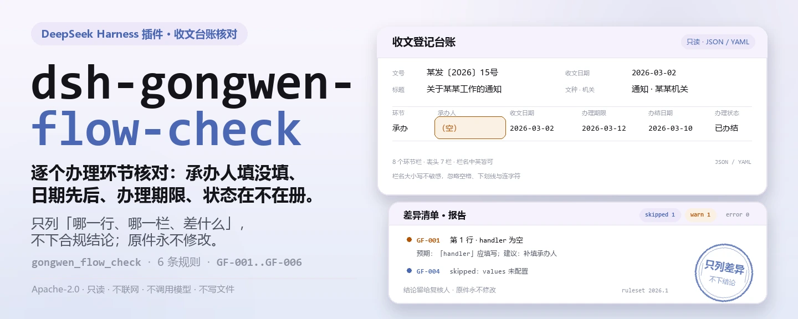
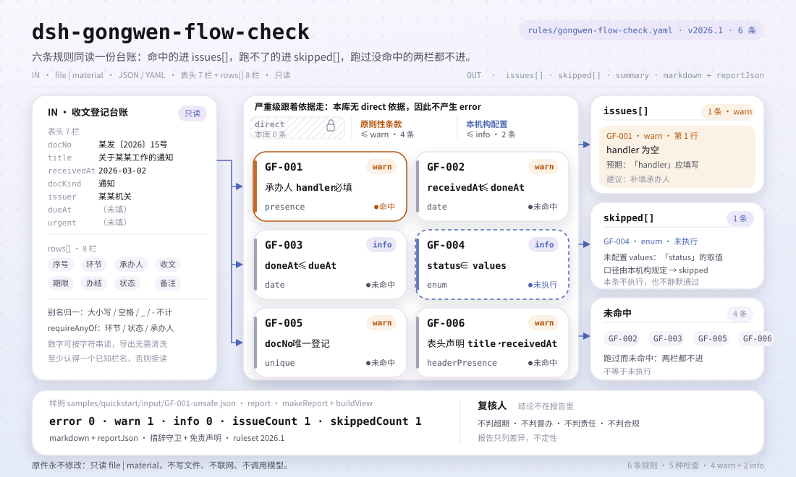

<div align="center">

<picture>
  <source media="(prefers-color-scheme: dark)" srcset="docs/assets/dsh-gongwen-flow-check-hero-zh-dark.webp">
  
</picture>

# dsh-gongwen-flow-check

**逐行核对收文登记与办理环节台账——承办人、收发文日期、办理期限、状态用词、文号唯一性与表头声明——拿回一份「哪一行、哪一栏、差什么」的清单。**

面向办公室文秘与机要员的 DeepSeek Harness 检查插件：规则包逐条引用《党政机关公文处理工作条例》原文，只列台账与条款之间的字面差异，不下合规结论、不认定责任、不修改原件。

[安装](#三步上手) · [配置](#配置) · [FAQ](#faq) · [简体中文](README.md) · [English](README.en.md) · [Español](README.es.md) · [Português](README.pt.md) · [हिन्दी](README.hi.md)

[](LICENSE)
[](#兼容性)
[](https://www.npmjs.com/package/dsh-gongwen-flow-check)
[](https://github.com/PerryLink/dsh-gongwen-flow-check/actions/workflows/ci.yml)
[](#兼容性)

[](https://github.com/PerryLink/dsh-gongwen-flow-check/stargazers)
[](https://www.npmjs.com/package/dsh-gongwen-flow-check)
[](https://dshfind.com/plugins/PerryLink/dsh-gongwen-flow-check?ref=badge)
[](https://securityscorecards.dev/viewer/?uri=github.com/PerryLink/dsh-gongwen-flow-check)
[](https://dsh.market/)
[](https://gitee.com/perrylink/dsh-gongwen-flow-check)

```sh
dsh plugin --profile <name> add dsh-gongwen-flow-check
```

</div>

<sub>社区插件，与 DeepSeek 官方无关。唯一仓库：<https://github.com/PerryLink/dsh-gongwen-flow-check>（Gitee 为镜像）。</sub>

## 它是什么

`dsh-gongwen-flow-check` 读取一份收文登记与办理环节台账——公文表头（`docNo`、`title`、`receivedAt` 等）加上每个办理环节一行——核对台账自身可以机械判定的事项：每个环节是否在 `handler` 栏填写承办人、`receivedAt` 与 `doneAt` 是否可解析为日期且先后成立、办结是否落在台账自己写入 `dueAt` 的办理期限之内、每个 `status` 是否取自你在 `values` 里配置的取值清单、`docNo` 是否只登记一次、表头是否同时声明 `title` 与 `receivedAt`。你交出原始材料（表格、清单或文书；Excel 可先转成 JSON/YAML，对话里也能代转），拿回一份「哪一行、哪一栏、差什么」的差异清单。它不判定办文是否超期、是否应当督办，也不判定由谁负责，并且绝不修改原件。

<picture>
  <source media="(prefers-color-scheme: dark)" srcset="docs/assets/dsh-gongwen-flow-check-flow-v5-dark.svg">
  
</picture>

## 三步上手

1. **安装**：

   ```sh
   dsh plugin --profile <name> add dsh-gongwen-flow-check
   ```

   也可以在 WorkBuddy / 扣子搜「文书与治理核对包」（总包，本检查是其中一项；上架以商城为准）。

2. **最小配置**（默认即可用）：

   ```yaml
   - insert:
       - id: dsh-gongwen-flow-check
         name: dsh-gongwen-flow-check
   ```

   全部可调项都在 `src/config.ts` 的 Schemastery schema 里，默认值开箱即用；逐条阈值在 `rules/` 下的规则包里。

3. **验证已生效**：

   ```sh
   dsh --profile <name> --dump-config | grep 'dsh-gongwen-flow-check'
   ```

   再跑一次自带样例（在仓库内先构建；约 1 分钟）：

   ```sh
   pnpm run build
   node samples/quickstart/run.mjs
   ```

   样例输入在 `samples/quickstart/input/`，期望输出在 `samples/quickstart/expected/result.json`，运行截图见 `docs/assets/quickstart.png`。

**卸载**：`dsh plugin --profile <name> remove dsh-gongwen-flow-check`（或从 profile patch 删掉该行）。

<details>
<summary>从 DSH Desktop 市场安装</summary>

所有 PerryLink 插件均可在 DSH Desktop 内置市场中浏览：**市场 → 来源 → 添加来源 → 粘贴** `https://perrylink-dsh-catalog.perrylink.workers.dev/catalog-source.json` **→ 选中**。安装仍需通过市场的 npm 身份校验与你的确认。

</details>

## 核心能力

本插件注册 `gongwen_flow_check` 工具：读入一份台账（公文表头 + 办理环节行），套用带版本的规则包，返回一份结构化报告。

- **规则包即数据** —— 检查规则全部在 `rules/gongwen-flow-check.yaml` 里，换规则不动代码；规则包在加载期校验，而非被信任。
- **严重级跟着依据走** —— 依据为原则性条款（`derived-from-principle`）的规则封顶 `warn`；依据为本机构配置（`institutional-configuration`）的阈值封顶 `info`；绝不会把原则或本地配置标成 `error`（有测试断言）。
- **空清单不等于没问题** —— 每一项无法执行的检查都会在 `skipped` 里自报原因；`GF-004` 的取值清单未配置时，规则自报 `skipped`，而不是静默通过。
- **不裁决** —— 报告只列差异，永不判定合规、责任或对错；措辞守卫强制报告始终携带免责声明。
- **引文必须逐字** —— 每条规则带文件名、文号、按原文自身编号体系的条款号、逐字摘录与来源链接；把转述包装成引文，或把原则性依据标成 `error`，都会在加载期失败。

```text
收文登记台账（表头 · 办理环节行）──gongwen_flow_check──▶ 规则包 GF-001…GF-006 ──▶ 报告（findings + skipped）
              ▲                                                                                 │
              └────────────────────────────── 原件永不修改 ───────────────────────────────────┘
```

### 规则一览

| 规则 | 核对内容 | 严重级 | 依据类型 |
|---|---|---|---|
| `GF-001` | 每个办理环节都填写承办人 | warn | 原则性条款 |
| `GF-002` | 收文日期与办结日期可解析且先后成立 | warn | 原则性条款 |
| `GF-003` | 办结日期落在台账写明的办理期限内 | info | 本机构配置 |
| `GF-004` | 办理状态取自你的取值清单（默认关闭） | info | 本机构配置 |
| `GF-005` | 公文文号在台账内唯一 | warn | 原则性条款 |
| `GF-006` | 台账表头声明公文标题与收文日期 | warn | 原则性条款 |

### 示例

以下为插件真实入口；安装后调用一次即可。

**详细输出** — 工具 `gongwen_flow_check`，输入（节选）：

```json
{"rows":[{"办理环节":"承办","承办人":"张科","收文日期":"2026-03-02","办理期限":"2026-03-12","办结日期":"2026-02-28"}]}
```

输出：

```json
{
  "id": "dsh-gongwen-flow-check.GF-002.de09b5a6",
  "ruleId": "GF-002",
  "severity": "warn",
  "locator": {
    "field": "receivedAt",
    "row": 1
  },
  "found": "第 1 行「receivedAt」为 2026-03-02，晚于 「doneAt」的 2026-02-28",
  "expected": "「receivedAt」不应晚于 2026-02-28",
  "fix": "办结日期不应早于收文日期；核对两个日期的填写"
}
```

*Observed from `tests/fixtures/GF-002/GF-002-unsafe.json (cases.json expects GF-002 count 1); run via lib/index.mjs rules/gongwen-flow-check.yaml`*

### 它回答什么问题

| 你会问 | 它怎么答 |
|---|---|
| 某个办理环节的承办人漏填了，台账会收到什么提示？ | `GF-001` 要求每个环节都填写 `handler` 栏，并把空着的那一行报出。它只核对这一栏是否填写，不判断办理是否及时——既不判断这个环节是否应当督办，也不判断由谁负责。 |
| 办结日期早于收文日期，能查出来吗？ | 能。`GF-002` 解析 `receivedAt` 与 `doneAt` 两个日期，先后不成立时逐行报出。它只比较台账自己写的这两个日期——同一天视为不晚于——不判断办理是否在时限内。解析不了的日期会单独报出，而不是静默跳过。 |
| 有一行始终没有登记办理期限，插件会假定一个期限吗？ | 不会。`GF-003` 只在台账自己把期限写入 `dueAt` 时运行；`dueAt` 为空则本条报告 `skipped`。条例本身不规定天数，插件也不硬编码任何天数，因此不会替使用方推算期限。命中只表示「与你写在台账里的期限不一致」，不表示「已构成超期未办」。 |
| 办理状态填了一个不在配置清单里的值。 | `GF-004` 在 `status` 所填值不在 `values` 配置清单中时报出该行。出厂时这份清单为空，表示未配置，故本条报告 `skipped`，而不是静默通过。它只核对所填值是否在册，不判断该公文当前实际处于哪个环节。 |
| 同一份公文的文号在台账里出现了两次。 | `GF-005` 要求 `docNo` 在台账内唯一，比较时忽略空白字符。命中通常意味着重复登记或文号抄错，需人工确认：文号重复会让人无法判断，到底是一份公文被登记了两次，还是两份不同公文被错编成了同一号。 |
| 台账本身没有声明公文标题与收文日期。 | `GF-006` 要求顶层同时声明 `title` 与 `receivedAt`，缺一即报出表头。它只核对这两栏是否声明，既不判断标题的形式是否规范，也不判断办理记录是否真的与该公文对应。 |

## 配置

全部可调参数都在 `src/config.ts` 的 Schemastery schema 中，只改 `cordis.yml` 即可生效，无需改代码；逐条阈值在 `rules/` 下的规则库文件里。全部配置键即下表 5 个；规则级参数见表后。

| 键 | 类型 | 默认值 | 说明 |
|---|---|---|---|
| `rulesFile` | string | `rules/gongwen-flow-check.yaml` | 规则库文件路径，相对插件包根目录 |
| `disabledRules` | string[] | `[]` | 要停用的规则 id 列表；每条都会出现在 `skipped` 中 |
| `onlyRules` | string[] | `[]` | 只执行这些规则 id；留空表示执行全部规则 |
| `skipNotes` | string | `""` | 附加到每条 `skipped` 说明后的备注 |
| `timeoutMs` | number | `120000` | 工具协作式超时预算（毫秒） |

值得知道的规则级参数：

- `GF-001` `field` —— 承办人栏，默认 `handler`。
- `GF-003` `dueAt` —— 台账的办理期限列；未记录期限时本条进 `skipped`，插件从不按天数推算。
- `GF-004` `values` —— 你的环节用词，如 `[待办, 承办中, 已办结, 已归档]`；留空表示未配置，本条不执行。
- `GF-005` —— 比较 `docNo` 时忽略空白字符。

profile patch 覆盖示例：

```yaml
- insert:
    - id: dsh-gongwen-flow-check
      name: dsh-gongwen-flow-check
      config:
        disabledRules: [GF-004]
        onlyRules: [GF-001, GF-002, GF-003]
        skipNotes: 本机关实施细则是本条的取值口径
```

## FAQ

<details>
<summary>我的材料会被改动或上传吗？</summary>

不会。工具只读取你交出的 JSON/YAML 材料文本（`file` 或 `material` 二选一），**绝不修改原件**；插件是纯 ESM、无原生代码、**不联网、不调用模型**（见「兼容性」），材料不离开你的机器。

</details>

<details>
<summary>没配状态清单、台账也没写期限时，会不会静默通过？</summary>

不会。`GF-004` 的 `values` 与 `GF-003` 所需的 `dueAt` 出厂均未配置，无法执行的检查会把自己报进 `skipped` 并写明原因——空的差异清单不会被读成「没有问题」。`GF-004` 只核对所填值是否在册，不判断公文实际处于哪个环节。

</details>

<details>
<summary>插件会判定「超期」吗？</summary>

不会。`GF-003` 把办结日期与**台账自身写明的**期限（`dueAt`）相比较；未记录期限时它报告 `skipped`，而不是假定一个天数。条例要求紧急公文明确办理时限、要求在规定时限内办结，但**不规定具体天数**，期限始终来自来文或本机构规定，插件从不自行拟定。命中只表示「这与所记录的期限不符」，**不表示**「这已逾期」——是否逾期还取决于催办、延期与公文自身的紧急程度。

</details>

<details>
<summary>日期能读哪些格式？看起来偏移是怎么回事？</summary>

读取器接受 `2026-03-02` 与 `2026-03-02 09:30`；形如「2026年3月2日」的写法会被刻意报为无法解析，以便你决定是否归一化导出。全部计算都是对输入字符串做墙上时钟运算，不做时区换算。

</details>

<details>
<summary>插件装上了但工具不出现，或安装时被判版本不兼容，怎么办？</summary>

确认 `main` 指向 `lib/index.mjs` 且 `pnpm run build` 已生成该文件；`main` 写错会让加载器静默跳过该条目。peer 范围覆盖 `0.1.x` 与 `0.2.x`；若运行时在其之外，可显式豁免：`dsh plugin --profile <name> allow-version dsh-gongwen-flow-check@0.1.0 --dsh-version <runtime> --accept-risk`。安装期的 peer 校验以运行时为准。

</details>

## 依据的标准

| 文件 | 文号 | 引用它的规则 |
|---|---|---|
| 《党政机关公文处理工作条例》 | 中办发〔2012〕14号（自 2012 年 7 月 1 日起施行） | GF-001, GF-002, GF-003, GF-004, GF-005, GF-006 |

**边界：** 本插件核对一份**收文登记与办理环节台账**，范围限于登记表可以机械判定的事项——每个环节是否写明承办人，收文日期与办结日期是否可解析且先后成立，办结是否落在台账自己写明的期限之内，办理状态是否取自你配置的取值口径，文号是否唯一，以及表头是否标明该公文。它**不**判定办理是否逾期、是否应当督办，也不判定由谁负责。条例要求紧急公文**明确办理时限**，并要求在规定时限内办结——**条例本身不规定任何天数**，因此期限始终来自来文或本机构自己的规定，本插件从不自行拟定任何期限。

> ### ⚠️ 本插件报告中的引文究竟以什么为依据
>
> **该条例的全文已经取得并核对。** 《党政机关公文处理工作条例》（中办发〔2012〕14号）已从中央政府门户网站逐字读取；`rules/evidence/` 下的核查报告记录了所核条款：第五条（原则）、第二十三条（公文办理的范围）、第二十四条（七项收文办理程序，包括「紧急公文应当明确办理时限」）与第四十二条（自 2012-07-01 起施行，取代此前两份文件）。规则库的 `excerpt` 字段现已回填为逐字引文，`pnpm run check:citations` 逐段对照证据文件复核——当前 10 段全部可溯源、0 段未溯源、基线为 0。
>
> **但每条规则仍是 `warn` 或 `info`，`kind` 也未升级为 `direct`**——这是有意为之。本插件核对的是*一份台账*是否齐备且自洽；条例规范的是公文如何被*办理*，这是另一个命题。把「这一栏是空的」标成对「办理应当详细记载」的 `direct` 引用，会把台账的缺口粉饰成违反条例，而这正是本系列插件要避免的过度主张。这项检查也把期限的长短留给来文与所在机构决定，正如第二十四条所做的那样。
>
> 《党政机关公文格式》（GB/T 9704-2012）**本次未取得**，况且本插件在任何情况下都不核对版式。
>
> 期限规则值得单独说明。`GF-003` 把办结日期与**台账自身写明的**期限（`dueAt`）相比较；未记录期限时，它报告自己进了 `skipped`，而不是假定一个天数。它的发现说的是「这与所记录的期限不符」，**而不是**「这已逾期」——是否逾期取决于催办、延期以及公文自身的紧急程度。

## 材料格式

工具接受 JSON 或 YAML：

```yaml
docNo: 某发〔2026〕15号
title: 关于某某工作的通知
docKind: 通知
issuer: 某某机关
receivedAt: 2026-03-02
rows:
  - { 序号: '1', 办理环节: 承办, 承办人: 张科, 收文日期: 2026-03-02,
      办理期限: 2026-03-12, 办结日期: 2026-03-10, 办理状态: 已办结 }
```

栏目名大小写不敏感，并忽略空格、下划线与连字符；台账自己的栏目名会被保留，因此发现会写明它读的是哪一栏。日期可以是 `2026-03-02` 或 `2026-03-02 09:30`。数字可按字符串接受，表格导出无需清洗。

## 规则来源

规则数据在 `rules/gongwen-flow-check.yaml`，与代码分离。每条规则携带文件名、文号、按原文自身编号体系的条款号、逐字摘录与来源链接。加载器强制：摘录必须是真实引文且不少于八个字符；依据仅为原则性条款（`kind: derived-from-principle`，严重级上限 `warn`）或本机构配置（`kind: institutional-configuration`，上限 `info`）的检查不得标为 `error`。夸大依据的规则库会在加载期失败，而不会产出一份看起来很有底气的报告。

规则库头部写明引用纪律，每条规则的 `note` 说明本条依据与它刻意不作出的结论；`rules/evidence/` 保存条款核查记录；`pnpm run check:citations` 逐段把 `excerpt` 与证据对照（当前 10 段全部可溯源、0 段未溯源、基线 0）。`GF-003` 的 `note` 单独说明：条例把时限的长短交给来文要求与本机关制度，插件不硬编码任何天数。

## 兼容性

| 项目 | 状态 |
|---|---|
| Harness | 对等版本范围 `>=0.1.2-rc.1 <0.2.0 \|\| >=0.2.0-0 <0.3.0` —— 已实测同时接受 `0.2.0-rc.2` 与 `0.2.1-rc.2`。已声明 `engines.dsh`：`>=0.2.1-0 <0.3.0`，0.2.1 起由宿主单独裁决 |
| Node | `^22.19.0 \|\| >=24.0.0` |
| 平台 | 全平台（纯 ESM；无原生代码、无联网、不调用模型） |
| 工具模式 | `native` / `ptc` 均可；批量校验一整年的台账时建议 `ptc`，schema 成本只付一次 |

## 故障排查

- **`GF-003` 自报 skipped。** 台账没有登记办理期限。这是有意为之：插件不会自行拟定期限，因为期限来自来文或你自己的办文制度。
- **`GF-003` 命中，但我认为办理是及时的。** 台账里的办理期限与办结日期不一致。要么期限栏过期，要么办结日期填错——发现会写明它比较的是哪两个单元格。
- **`GF-004` 从不运行。** 它的取值清单为空；填入本机构的环节用词即可。
- **`GF-002` 对我能读的日期报错。** 读取器接受 `2026-03-02` 与 `2026-03-02 09:30`；「2026年3月2日」会被刻意报为无法解析。
- **插件装上了但工具不出现。** 确认 `main` 指向 `lib/index.mjs` 且 `pnpm run build` 已生成该文件；`main` 写错会让加载器静默跳过该条目。
- **`dsh plugin add` 以不兼容为由拒绝。** peer 范围覆盖 `0.1.x` 与 `0.2.x`；若运行时在其之外，可显式豁免：`dsh plugin --profile <name> allow-version dsh-gongwen-flow-check@0.1.0 --dsh-version <runtime> --accept-risk`
- **`check` 报 `manifest-peers` 失败。** 静态检查器比对的是一份早于 0.2 世代的硬编码 peer 范围；安装期的 peer 校验以运行时为准，声明的范围才是正确的。这是 `dsh-plugin-dev` 的已知上游问题。
- **时间看起来偏移。** 全部计算都是对输入字符串做墙上时钟运算，不做时区换算。

## 生态与质量

- [Gitee 镜像](https://gitee.com/perrylink/dsh-gongwen-flow-check)（同步镜像，以 GitHub 为准）
- [dshfind 插件页](https://dshfind.com/plugins/PerryLink/dsh-gongwen-flow-check)（安装量与排名）
- [OpenSSF Scorecard 报告](https://securityscorecards.dev/viewer/?uri=github.com/PerryLink/dsh-gongwen-flow-check)（由 [.github/workflows/scorecard.yml](.github/workflows/scorecard.yml) 驱动）
- [DSH Market](https://dsh.market/)（已上架）
- [生态实测知识库 · 按材料选核查器](https://perrylink.github.io/zh/checkers/choose/)（完整家族清单：62 个核查器 + 通用插件）

## 开发

```sh
pnpm install
pnpm run typecheck   # tsc --noEmit
pnpm test            # vitest，共享表格插件套件 + 每条规则的配对夹具（tests/fixtures/<RULE>/）
pnpm run build       # tsdown -> lib/index.mjs + lib/index.d.mts
pnpm run check:readmes     # 五语 README 一致性
pnpm run check:citations   # 逐段核对规则引文与 rules/evidence/
node ../scripts/sync-shared.mjs dsh-gongwen-flow-check   # 从 ../_shared 刷新 src/shared
```

插件是**数据驱动**的：`src/model.ts` 声明表格形状，共享件提供读取器与检查引擎，规则包声明每一项检查。改 `rules/*.yaml` 即切换规则集，无需动 TypeScript；规则包在加载期校验，而非被信任。README 配图由 [`scripts/gen-readme-assets.py`](scripts/gen-readme-assets.py) 程序化生成，可重复执行：hero 横幅用 Pillow（zh / en × 深浅共四张），结构图是手写 SVG（深浅双版，图内以命令面 token、真实样例值与简短说明标注）。旧单版流程图、旧 hero 与演示图保留在 `docs/assets/` 供外链使用，README 只引用新生成的 hero 与 flow-v5 图。

## 家族与致谢

本项目是 [PerryLink](https://github.com/PerryLink) 维护的 DeepSeek Harness 插件家族成员（全部 Apache-2.0）。如果这个插件帮到了你，**给个 star**——它不解锁任何功能，但会让下一个人更容易找到它。

- [@PerryLink](https://github.com/PerryLink) —— 创建者与维护者：`gongwen_flow_check` 工具、逐字引文的规则包与条款核验记录、五语文档。

<details>
<summary>展开全部插件</summary>

| 插件 | 状态 |
|---|---|
| **[dsh-aqua-input-check](https://github.com/PerryLink/dsh-aqua-input-check)** |  |
| **[dsh-archive-check](https://github.com/PerryLink/dsh-archive-check)** |  |
| **[dsh-auto-review](https://github.com/PerryLink/dsh-auto-review)** |  |
| **[dsh-autotier](https://github.com/PerryLink/dsh-autotier)** | 🧊 已冻结 — 见仓库 README |
| **[dsh-bid-ca-precheck](https://github.com/PerryLink/dsh-bid-ca-precheck)** |  |
| **[dsh-bid-qual-check](https://github.com/PerryLink/dsh-bid-qual-check)** |  |
| **[dsh-cert-mcp](https://github.com/PerryLink/dsh-cert-mcp)** | 🧊 已冻结 — 见仓库 README |
| **[dsh-checkpoint-rewind](https://github.com/PerryLink/dsh-checkpoint-rewind)** |  |
| **[dsh-click](https://github.com/PerryLink/dsh-click)** |  |
| **[dsh-composer-history](https://github.com/PerryLink/dsh-composer-history)** |  |
| **[dsh-contract-stance](https://github.com/PerryLink/dsh-contract-stance)** |  |
| **[dsh-customs-doc-check](https://github.com/PerryLink/dsh-customs-doc-check)** |  |
| **[dsh-data-quality](https://github.com/PerryLink/dsh-data-quality)** | 🧊 已冻结 — 见仓库 README |
| **[dsh-demurrage-ledger](https://github.com/PerryLink/dsh-demurrage-ledger)** |  |
| **[dsh-doublecheck](https://github.com/PerryLink/dsh-doublecheck)** |  |
| **[dsh-drill-script-check](https://github.com/PerryLink/dsh-drill-script-check)** |  |
| **[dsh-eia-guide-check](https://github.com/PerryLink/dsh-eia-guide-check)** |  |
| **[dsh-emergency-plan](https://github.com/PerryLink/dsh-emergency-plan)** |  |
| **[dsh-essay-rubric-check](https://github.com/PerryLink/dsh-essay-rubric-check)** |  |
| **[dsh-evidence-check](https://github.com/PerryLink/dsh-evidence-check)** |  |
| **[dsh-export-ctl-check](https://github.com/PerryLink/dsh-export-ctl-check)** |  |
| **[dsh-fast](https://github.com/PerryLink/dsh-fast)** |  |
| **[dsh-fmea-table-check](https://github.com/PerryLink/dsh-fmea-table-check)** |  |
| **[dsh-forecast-penalty](https://github.com/PerryLink/dsh-forecast-penalty)** |  |
| **[dsh-fund-research](https://github.com/PerryLink/dsh-fund-research)** |  |
| **[dsh-github](https://github.com/PerryLink/dsh-github)** |  |
| **[dsh-gongwen-flow-check](https://github.com/PerryLink/dsh-gongwen-flow-check)** |  |
| **[dsh-gongwen-word-check](https://github.com/PerryLink/dsh-gongwen-word-check)** |  |
| **[dsh-guard-plan-qc](https://github.com/PerryLink/dsh-guard-plan-qc)** |  |
| **[dsh-hazchem-check](https://github.com/PerryLink/dsh-hazchem-check)** |  |
| **[dsh-hazplan-check](https://github.com/PerryLink/dsh-hazplan-check)** |  |
| **[dsh-hidden-risk-map](https://github.com/PerryLink/dsh-hidden-risk-map)** |  |
| **[dsh-hs-classify](https://github.com/PerryLink/dsh-hs-classify)** |  |
| **[dsh-icd-rule-check](https://github.com/PerryLink/dsh-icd-rule-check)** |  |
| **[dsh-industry-research](https://github.com/PerryLink/dsh-industry-research)** |  |
| **[dsh-lawcite-adapter](https://github.com/PerryLink/dsh-lawcite-adapter)** |  |
| **[dsh-laya](https://github.com/PerryLink/dsh-laya)** |  |
| **[dsh-lc-doc-check](https://github.com/PerryLink/dsh-lc-doc-check)** |  |
| **[dsh-learning-gap-check](https://github.com/PerryLink/dsh-learning-gap-check)** |  |
| **[dsh-library](https://github.com/PerryLink/dsh-library)** |  |
| **[dsh-local-ai](https://github.com/PerryLink/dsh-local-ai)** |  |
| **[dsh-lsp-actions](https://github.com/PerryLink/dsh-lsp-actions)** |  |
| **[dsh-mask](https://github.com/PerryLink/dsh-mask)** |  |
| **[dsh-mcp-panel](https://github.com/PerryLink/dsh-mcp-panel)** |  |
| **[dsh-medrec-qc](https://github.com/PerryLink/dsh-medrec-qc)** |  |
| **[dsh-memento](https://github.com/PerryLink/dsh-memento)** | 🧊 已冻结 — 见仓库 README |
| **[dsh-nsfc-form-check](https://github.com/PerryLink/dsh-nsfc-form-check)** |  |
| **[dsh-nurse-record-check](https://github.com/PerryLink/dsh-nurse-record-check)** |  |
| **[dsh-observe](https://github.com/PerryLink/dsh-observe)** |  |
| **[dsh-origin-rvc-check](https://github.com/PerryLink/dsh-origin-rvc-check)** |  |
| **[dsh-ota-review-check](https://github.com/PerryLink/dsh-ota-review-check)** |  |
| **[dsh-output-styles](https://github.com/PerryLink/dsh-output-styles)** |  |
| **[dsh-paper-doc-adapter](https://github.com/PerryLink/dsh-paper-doc-adapter)** |  |
| **[dsh-permission-rules](https://github.com/PerryLink/dsh-permission-rules)** |  |
| **[dsh-permit-report-check](https://github.com/PerryLink/dsh-permit-report-check)** |  |
| **[dsh-pipeline-check](https://github.com/PerryLink/dsh-pipeline-check)** |  |
| **[dsh-pleading-draft](https://github.com/PerryLink/dsh-pleading-draft)** |  |
| **[dsh-plugin-doctor](https://github.com/PerryLink/dsh-plugin-doctor)** | 🚫 已退役（仓库已归档） |
| **[dsh-plugin-guide](https://github.com/PerryLink/dsh-plugin-guide)** |  |
| **[dsh-plugin-kit](https://github.com/PerryLink/dsh-plugin-kit)** | 🚫 已退役（仓库已归档） |
| **[dsh-plugin-upgrade](https://github.com/PerryLink/dsh-plugin-upgrade)** | 🚫 已退役（仓库已归档） |
| **[dsh-policy-brief-draft](https://github.com/PerryLink/dsh-policy-brief-draft)** |  |
| **[dsh-power-loss-split](https://github.com/PerryLink/dsh-power-loss-split)** |  |
| **[dsh-power-ticket-check](https://github.com/PerryLink/dsh-power-ticket-check)** |  |
| **[dsh-ppap-check](https://github.com/PerryLink/dsh-ppap-check)** |  |
| **[dsh-protest-deadline](https://github.com/PerryLink/dsh-protest-deadline)** |  |
| **[dsh-railway-window](https://github.com/PerryLink/dsh-railway-window)** |  |
| **[dsh-repair-order-qc](https://github.com/PerryLink/dsh-repair-order-qc)** |  |
| **[dsh-research-report](https://github.com/PerryLink/dsh-research-report)** |  |
| **[dsh-review-reply-check](https://github.com/PerryLink/dsh-review-reply-check)** |  |
| **[dsh-rulefile-check](https://github.com/PerryLink/dsh-rulefile-check)** |  |
| **[dsh-safety-brief-check](https://github.com/PerryLink/dsh-safety-brief-check)** |  |
| **[dsh-score](https://github.com/PerryLink/dsh-score)** | 🧊 已冻结 — 见仓库 README |
| **[dsh-session-sync](https://github.com/PerryLink/dsh-session-sync)** |  |
| **[dsh-site-log-check](https://github.com/PerryLink/dsh-site-log-check)** |  |
| **[dsh-skill-pack-security](https://github.com/PerryLink/dsh-skill-pack-security)** |  |
| **[dsh-soe-decision-check](https://github.com/PerryLink/dsh-soe-decision-check)** |  |
| **[dsh-soilwater-check](https://github.com/PerryLink/dsh-soilwater-check)** |  |
| **[dsh-sop-sync-check](https://github.com/PerryLink/dsh-sop-sync-check)** |  |
| **[dsh-spc-gbt-adapter](https://github.com/PerryLink/dsh-spc-gbt-adapter)** |  |
| **[dsh-talk](https://github.com/PerryLink/dsh-talk)** |  |
| **[dsh-tender-extract](https://github.com/PerryLink/dsh-tender-extract)** |  |
| **[dsh-tender-matrix](https://github.com/PerryLink/dsh-tender-matrix)** |  |
| **[dsh-test-drive](https://github.com/PerryLink/dsh-test-drive)** |  |
| **[dsh-ticktick](https://github.com/PerryLink/dsh-ticktick)** | 🚫 已退役（仓库已归档） |
| **[dsh-translate](https://github.com/PerryLink/dsh-translate)** |  |
| **[dsh-warranty-calc](https://github.com/PerryLink/dsh-warranty-calc)** |  |
| **[dsh-budget](https://github.com/PerryLink/dsh-budget)** | 🧊 已冻结 — 见仓库 README |
| **[dsh-claude-move](https://github.com/PerryLink/dsh-claude-move)** | 🧊 已冻结 — 见仓库 README |
| **[dsh-defend](https://github.com/PerryLink/dsh-defend)** | 🧊 已冻结 — 见仓库 README |
| **[dsh-draw](https://github.com/PerryLink/dsh-draw)** | 🧊 已冻结 — 见仓库 README |
| **[dsh-reach](https://github.com/PerryLink/dsh-reach)** | 🧊 已冻结 — 见仓库 README |
| **[dsh-background-agents](https://github.com/PerryLink/dsh-background-agents)** | 🚫 已退役（仓库已归档） |
| **[dsh-session-pin](https://github.com/PerryLink/dsh-session-pin)** | 🚫 已退役（仓库已归档） |
| **[dsh-team-rooms](https://github.com/PerryLink/dsh-team-rooms)** | 🚫 已退役（仓库已归档） |

</details>

## License

[LICENSE](LICENSE)（Apache License 2.0）© 2026 dsh-gongwen-flow-check contributors

<p align="center"><sub>Apache-2.0 · 社区插件，与 DeepSeek 无关。</sub></p>
